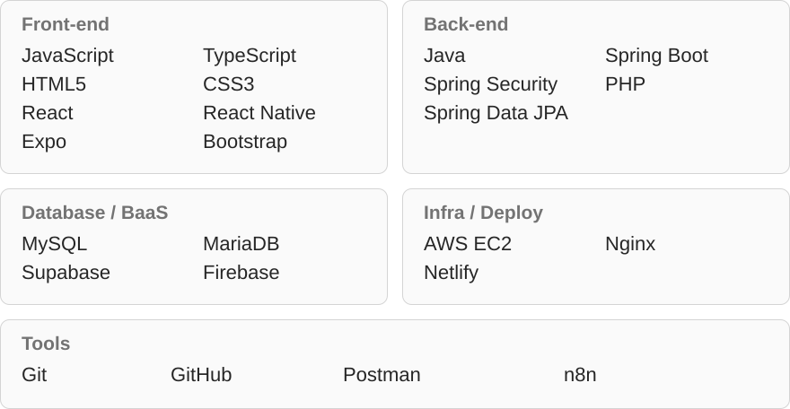

<h3 align="center">Contact &amp; Links</h3>

  <a href="https://app.notion.com/p/3d95ca61467280b1be85d3c5d973c69e" title="Notion 이력서 보기"><picture>
      <source media="(prefers-color-scheme: dark)" srcset="./assets/contact/notion.svg?v=mono-1" />
      <source media="(prefers-color-scheme: light)" srcset="./assets/contact/notion-light.svg?v=mono-1" />
      
    </picture></a>
  <a href="https://hlxecz.tistory.com" title="H.Dev Log 기술 블로그"><picture>
      <source media="(prefers-color-scheme: dark)" srcset="./assets/contact/blog.svg?v=mono-1" />
      <source media="(prefers-color-scheme: light)" srcset="./assets/contact/blog-light.svg?v=mono-1" />
      
    </picture></a>

<h2 align="center">Tech Stack</h2>

  <picture>
    <source media="(prefers-color-scheme: dark) and (max-width: 620px)" srcset="./assets/stack/stack-dark-compact.svg" />
    <source media="(prefers-color-scheme: light) and (max-width: 620px)" srcset="./assets/stack/stack-light-compact.svg" />
    <source media="(prefers-color-scheme: dark)" srcset="./assets/stack/stack-dark.svg" />
    
  </picture>

<h2 align="center">GitHub Activity</h2>

  <picture>
    <source media="(prefers-color-scheme: dark)" srcset="https://raw.githubusercontent.com/Hlxecz/Hlxecz/output/github-stats-dark.svg?v=mono-1" />
    <source media="(prefers-color-scheme: light)" srcset="https://raw.githubusercontent.com/Hlxecz/Hlxecz/output/github-stats-light.svg?v=mono-1" />
    
  </picture>

  <picture>
    <source media="(prefers-color-scheme: dark)" srcset="https://raw.githubusercontent.com/Hlxecz/Hlxecz/output/github-activity-dark.svg?v=mono-1" />
    <source media="(prefers-color-scheme: light)" srcset="https://raw.githubusercontent.com/Hlxecz/Hlxecz/output/github-activity-light.svg?v=mono-1" />
    
  </picture>

<h3 align="center">Contribution Snake</h3>

  <picture>
    <source media="(prefers-color-scheme: dark)" srcset="https://raw.githubusercontent.com/Hlxecz/Hlxecz/output/github-contribution-grid-snake-dark.svg?v=mono-1" />
    <source media="(prefers-color-scheme: light)" srcset="https://raw.githubusercontent.com/Hlxecz/Hlxecz/output/github-contribution-grid-snake.svg?v=mono-1" />
    
  </picture>

