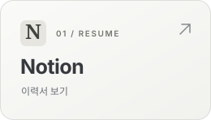
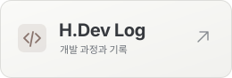

<h2 align="center">Contact &amp; Links</h2>

이력서 · 개발 기록 · 연락처

  <a href="https://app.notion.com/p/3d95ca61467280b1be85d3c5d973c69e" title="Notion 이력서 보기"><picture>
      <source media="(prefers-color-scheme: dark)" srcset="./assets/contact/notion.svg" />
      <source media="(prefers-color-scheme: light)" srcset="./assets/contact/notion-light.svg" />
      
    </picture></a>
  <a href="https://hlxecz.tistory.com" title="H.Dev Log 기술 블로그"><picture>
      <source media="(prefers-color-scheme: dark)" srcset="./assets/contact/blog.svg" />
      <source media="(prefers-color-scheme: light)" srcset="./assets/contact/blog-light.svg" />
      
    </picture></a>

  <a href="mailto:azaz3769@gmail.com">✉&nbsp; azaz3769@gmail.com</a>

 

<h2>🛠 Tech Stack</h2>

<table width="100%">
  <thead>
    <tr>
      <th align="left" width="170">Field</th>
      <th align="left">Stack</th>
    </tr>
  </thead>
  <tbody>
    <tr>
      <td><strong>Front-end</strong></td>
      <td>
           
         
           
      </td>
    </tr>
    <tr>
      <td><strong>Back-end</strong></td>
      <td>
          
         
         
      </td>
    </tr>
    <tr>
      <td><strong>Database / BaaS</strong></td>
      <td>
           
      </td>
    </tr>
    <tr>
      <td><strong>Infra / Deploy</strong></td>
      <td>
          
      </td>
    </tr>
    <tr>
      <td><strong>Tools</strong></td>
      <td>
           
      </td>
    </tr>
  </tbody>
</table>

 

<h2>📊 GitHub Stats</h2>

---

## 📈 Contribution Graph

---

## 🐍 Contribution Snake

---
