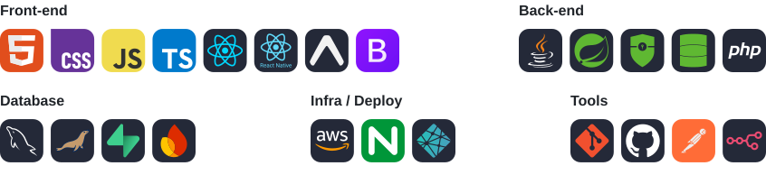

  <a href="https://app.notion.com/p/3d95ca61467280b1be85d3c5d973c69e" title="이력서 보기 · 프로젝트와 경험을 한눈에">
    <picture>
      <source media="(prefers-color-scheme: dark)" srcset="./assets/contact-preview/notion-dark.svg" />
      
    </picture>
  </a>
  <a href="https://hlxecz.tistory.com" title="H.Dev Log · 개발 경험을 담은 기술 블로그">
    <picture>
      <source media="(prefers-color-scheme: dark)" srcset="./assets/contact-preview/blog-dark.svg" />
      
    </picture>
  </a>

 

<h2>🛠 Tech Stack</h2>

  <picture>
    <source media="(prefers-color-scheme: dark) and (max-width: 620px)" srcset="./assets/stack-spacing/compact-dark.svg" />
    <source media="(prefers-color-scheme: light) and (max-width: 620px)" srcset="./assets/stack-spacing/compact-light.svg" />
    <source media="(prefers-color-scheme: dark) and (max-width: 1000px)" srcset="./assets/stack-spacing/medium-dark.svg" />
    <source media="(prefers-color-scheme: light) and (max-width: 1000px)" srcset="./assets/stack-spacing/medium-light.svg" />
    <source media="(prefers-color-scheme: dark)" srcset="./assets/stack-spacing/wide-dark.svg" />
    
  </picture>

 

<h2>📊 GitHub Stats</h2>

---

## 📈 Contribution Graph

---

## 🐍 Contribution Snake

  <picture>
    <source media="(prefers-color-scheme: dark)" srcset="https://raw.githubusercontent.com/Hlxecz/Hlxecz/output/github-contribution-grid-snake-contrast-dark.svg" />
    <source media="(prefers-color-scheme: light)" srcset="https://raw.githubusercontent.com/Hlxecz/Hlxecz/output/github-contribution-grid-snake-contrast.svg" />
    
  </picture>

---
